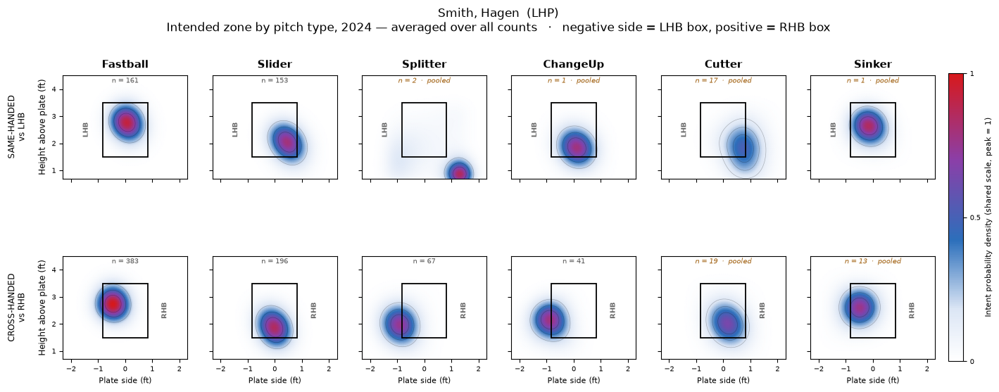

# Pitcher Command from Inferred Intent

Estimates how well a pitcher commands the baseball by recovering, for every
pitch, a probability distribution over where he was trying to throw it —
rather than assuming a single target. Fit in PyMC on one season (2024) of
pitch-level TrackMan rows, 496 pitchers and 134,895 pitches.

It is a three-stage hierarchical model. Each stage removes one component of a
pitch's location that is not the pitcher's choice — what the league does with
that pitch shape in that count, and how that particular hitter gets worked — and
the last stage splits what remains into intent and miss, with per-pitcher effects
pooled toward comparable pitchers by how much each one's own data supports them.

The data carries the count on every pitch, and Stage 3 does not use it. Count
is largely an indicator of how the league changes its target, and Stage 1's
`u_tc` term already removes that directly, in feet, at 83 pitch-type × count
levels. Giving the pitcher his own per-count target on top of that would let the
model reclassify a genuine miss as a deliberate change of plan, and it fragmented
the pooling groups to roughly 1.9 cells each.

Code layout, environment setup and how to run the scripts are in
[CODE_DOCUMENTATION.md](CODE_DOCUMENTATION.md).

---

## Model: Architecture and Decisions

```
Stage 1   y[i]      ~ StudentT(nu, mu_pop[i], sigma_pop[i])
          mu_pop    = alpha + f_move(HB, IVB) + f_velo(velo) + u_tps + u_tc
          log sigma_pop = s0 + g_move(HB, IVB) + s_type + s_count + s_matchup

Stage 2   r1[i]     = y[i] - mu_pop[i]
          r1[i]     ~ StudentT(nu, omega[b(i)], sigma_pop[i])
          omega[b]  = eta[g(b)] + omega_raw[b] * tau       non-centered
          eta[g]    = eta_raw[g] * tau_bin                 non-centered

Stage 3   r2[i]     = r1[i] - omega[b(i)]
          eta_c     = (g[group(c)] + eps_c) @ T'           81 knot logits
          w_c       = softmax(eta_c)                       the intent surface
          r2[i]     ~ sum_m w[c(i), m] * N(knot_m, sigma[i]^2 + bw^2)

          miss[i]   = sum_m p[i,m] * || r2[i] - knot_m ||
          Command+  = 100 - (avg_miss - mean) / sd * 10
```

The same thing in words. Every pitch's location is four things added together,
and the metric is the size of the last one:

```
where the pitch went  =  what the league does with this shape, in this count   mu_pop
                      +  how this particular hitter gets worked                omega
                      +  where THIS pitcher was trying to put it               intent
                      +  how far he missed                                     miss
```

Height and side are fit as two separate models through Stages 1 and 2, and
only rejoin in Stage 3, where the execution kernel is bivariate and carries a
fitted height/side correlation. Everything is fit in a mirrored frame: plate
side, horizontal break and release side are all reflected for left-handed
pitchers, so the model sees `same`-handed and `opposite`-handed matchups rather
than four hand combinations. That halves the number of categorical levels and
doubles the pitches behind each. Anything with a left/right orientation is
flipped back before it is reported.

### `mu_pop` — the population location

Where the league puts this pitch shape in this count against this hand. It
is subtracted first, so nothing downstream has to re-learn that a slider to a
same-handed hitter lives low and away.

Movement enters as a joint 2-D spline surface over horizontal and induced
vertical break — 56 basis columns, group-centered on pitch type. 

Release speed enters as an additive 1-D smooth, for the height model only,
fit orthogonal to the movement surface so the two cannot trade the same variance.
It is dropped from the side model. That is an empirical finding, not a
simplification: with the smooth in, the side fit came back at R-hat 1.50 and ESS
7 on `tau_velo` while every other parameter in the stage sat at 1.02 or below,
with chains splitting bimodally (0.08, 0.08, 4.40, and one wandering 0.006–5.95)
and the disagreement confined to the top three basis coefficients over a velocity
region holding 1,803 of 140,139 pitches. Once horizontal movement is in the
surface, release speed carries no independent information about aim side, so
the scale has nothing anchoring it. Height is the opposite case — speed governs
drop, the data pin the smooth, and all four chains agree on the coefficients to
three decimals.

The categorical block is `u_tps` (pitch type × matchup, 14 levels) and `u_tc`
(pitch type × count, 83 levels). There is no separate count main effect: pitch
type × count already spans count, and a main effect on top of it came back at
0.021 with an HDI touching zero and the worst mixing in the stage.

`sigma_pop` is its own log-linear submodel, not a constant. Execution spread
genuinely varies by pitch shape, type, count and matchup, and Stage 3 divides by
it — so a fastball and a curveball are not held to the same standard of "close."

### `omega` — the batter effect

One value per batter × pitch type, three-level partial pooling: global →
exit-velocity octile × pitch type → the batter cell itself. 5,018 batter ×
pitch-type groups sit under 124 octile levels with a median of 44 batters each
and no singletons.

The pooling target is deliberately crossed on the raw pitch type rather than
the movement sub-cluster. A sparse batter's `omega` on a slider should shrink
toward what comparable hitters get on sliders, not toward his own average over
every pitch — and against the sub-clusters this key produced 398 levels of which
28% held a single batter.

Both levels are non-centered. Realized spread is 0.048 ft (height) and 0.053 ft
(side) — real, and about two-thirds the size of the population surface itself.

### the intent surface — where he was trying to throw


Each pitcher × pitch type × batter side cell gets a continuous density over
the plate: a mixture of 81 Gaussian bumps on a 9×9 grid at 0.30 ft spacing, with
weights from a softmax so they sum to exactly 1. The bumps are basis centers, not
zones and not targets — the surface is evaluable at any coordinate, and nothing
is ever binned.

Execution noise is convolved in analytically. The pitch he actually threw is the
intended location plus a bivariate error with the per-pitch `sigma_pop` and a
fitted height/side correlation, and because both halves are Gaussian the
variances simply add:

```
p(y) = sum_m w_m * N(y | knot_m, sigma^2 + bw^2)
```

The integral over the plate never
has to be computed numerically, the whole (N × 81) kernel matrix is constant, and
the entire likelihood is a gather plus a `logsumexp`.

Pooling is one rung: a cell shrinks toward its (fastball-velo octile × pitch type
× batter side) group, 124 levels with a median of 30 pitcher-cells each. A cell
with fewer than 30 pitches carries no free deviation at all — it is its
group's surface, fully shrunk. 1,309 of 3,850 cells clear that bar, covering
82.2% of pitches.

Stage 3 is fit by penalized maximum likelihood (L-BFGS), not MCMC. The parameter
posterior is not read by anything downstream — the output is the per-pitch intent
distribution `p(x | y)`, which is derived from the fitted surface rather than
from uncertainty about it. Sampling 28,660 parameters to characterize a posterior
nothing consumes projected out to roughly 23 hours. The optimizer converges in 82
iterations and 1m53s. What is genuinely given up is credible intervals on the
surfaces themselves; the model is unchanged and can be sampled if they are ever
wanted.

### `miss` and Command+

Miss is an expectation over the intent posterior, not a distance to a point:

```
miss[i] = integral || y[i] - x || p(x | y[i]) dx  =  sum_m p[i,m] * || y[i] - knot_m ||
```

An earlier version scored each pitch against two
fitted targets using prior weights, which charged every pitch the distance to
targets it was not going for — a pitch landing perfectly on the primary target
still scored `(1-w) × separation`, that floor spanned 0.297 ft of a 0.390 ft
total range, and target separation alone explained R² = 0.47 of average miss.

Two versions are reported. `Command_Plus_Raw` uses raw feet; `Command_Plus_Adj`
divides by the per-pitch execution ellipse first, so a pitcher is measured
against the spread his pitch shapes actually carry. Both are scaled so 100 is
league average and 10 points is one standard deviation, with lower miss scoring
higher. Leaderboard qualification is 300 scored pitches.

---

## Priors

The priors are empirically determined — each scale is computed from the data
rather than set by hand.

| Prior on | What it measures | How it's computed |
|---|---|---|
| `tau_move`, `tau_velo` | how much aim varies across the movement plane | calibrated on the function, not the coefficients: an i.i.d. prior over the basis gives a surface with pointwise SD ≈ `tau × basis_scale`, so the rate is divided by that scale |
| `tau_tps`, `tau_tc` | spread of the categorical aim effects | carried forward from the per-cluster cell priors they replace, so the surface believes in the same amount of structure the cells did |
| `tau` (Stage 2) | how far one batter's effect sits from the league | between-batter variance of the Stage 1 residual, net of within-batter noise |
| `tau_bin` (Stage 2) | how far one exit-velo octile sits from global | the same estimator applied to the spread of octile means — far smaller, so the prior is correspondingly tighter |
| `nu` | tail weight of execution error | sampled in Stage 1, then fixed downstream rather than re-estimated |
| height/side correlation | tilt of the miss ellipse | plug-in from Stage 2 residuals per (velo octile × pitch type × matchup), shrunk toward 0 by cell count |
| `lambda` (Stage 3) | how hard to penalize surface wiggliness | selected on a held-out 10% of pitches, not set |

The 2024 fit derives:

| Prior on | height | side |
|---|---|---|
| `tau` (Stage 2), implied prior mean | 0.279 ft | 0.284 ft |
| `tau_bin` (Stage 2), implied prior mean | 0.112 ft | 0.135 ft |
| movement surface rate | 0.83 | 0.62 |
| velo smooth rate | 0.85 | not fitted |

Stage 3's smoothing penalty is chosen rather than assumed, and the grid is
reported in full below.

---

## Validation Design

One season, so there is no walk-forward. Everything below is 2024, and the
only out-of-sample number in the pipeline is Stage 3's held-out 10% of pitches
(13,489 held out against 121,406 trained), used both to select `lambda` and to
score the intent surface against a uniform one.

Two structural facts that limit what the diagnostics can tell you.

The stages pass point estimates, not distributions. Stage 2 consumes Stage
1's fitted `mu_pop` as a fixed offset; Stage 3 consumes both. A stage cannot hand
a distribution forward — there is no way to subtract a bimodal `mu_pop` — which
is exactly why the intent mixture lives in Stage 3 and nowhere else. The
consequence is that a downstream stage converges cleanly even when an upstream
number is wrong: it simply absorbs the error into `omega` or into intent. Clean
Stage 2 and Stage 3 diagnostics are evidence about Stage 2 and Stage 3 geometry,
and are not a vote of confidence in the numbers they condition on. 

Mirroring assumes perfect left/right symmetry. A left-handed batter facing a
righty and a right-handed batter facing a lefty are the same cell. If there is a
real asymmetry that is not a platoon effect — an asymmetrically called zone, say
— the frame cannot represent it, and it will be absorbed as pitcher deviation.
That assumption has not been tested.

There is no external validation. Nothing here is scored against outcomes.
Command+ has not been checked for year-over-year stability, for correlation with
walk rate or contact quality, or against any independent measure of command. The
model is internally coherent and its held-out likelihood beats the null, and that
is the whole of the current evidence.

---

## Results

The 2024 pipeline runs in 5h 52m: Stage 1 at 2,000 draws × 4 chains after 2,000
tuning steps (5h 35m), Stage 2 at 1,000 × 4 after 1,000 (15m 17s), Stage 3 by
optimization (1m 53s).

### Sampler health

| Stage | Dim | Divergences | Max R-hat | Min ESS | Verdict |
|---|---|---|---|---|---|
| 1 | height | 0 | 1.0071 | 1,097 | clean |
| 1 | side | 0 | 1.0069 | 849 | clean |
| 2 | height | 0 | 1.0000 | 1,533 | clean |
| 2 | side | 0 | 1.0000 | 1,259 | clean |
| 3 | joint | — | — | — | L-BFGS, converged in 82 iterations |

R-hat is the unrounded maximum over all monitored parameters. The run log prints
these as `1.0100` and flags them, which is an artifact: `az.summary` rounds to
two decimals before the comparison against the 1.01 threshold, so a true
1.0071 is tested as 1.01 and fails a strict inequality. The fits are converged.

That table is the second attempt. The first, with the velo smooth in the side
model, produced 43 divergences, R-hat 1.50 and ESS 7 in Stage 1 side — and both
downstream stages still reported zero divergences and R-hat 1.00. Removing the
term fixed it, and doubling Stage 1's draws from 1,000 took height from 1.02 to
1.007.

### Posterior scales

| Parameter | height | side | what it is |
|---|---|---|---|
| `tau_move` | 0.389 | 0.454 | movement surface amplitude |
| `tau_velo` | 0.681 | not fitted | velo smooth amplitude |
| `tau_tps` | 0.246 | 0.403 | spread across type × matchup |
| `tau_tc` | 0.146 | 0.080 | spread across type × count |
| `nu` | 20.3 | 24.3 | execution tail weight |
| `tau` (Stage 2) | 0.104 | 0.110 | between-batter |
| `tau_bin` (Stage 2) | 0.024 | 0.012 | between exit-velo octile |

`tau_bin` sitting at a fifth of `tau` in height and a tenth in side is the
octile rung doing its job and no more: batters differ, exit-velo octiles differ
much less, and the model says so rather than being told.

### Is there real signal in each effect

Every row in feet, so the four are directly comparable against each other:

| effect | height | side | the span it covers |
|---|---|---|---|
| population location, `mu_pop` | 0.074 | 0.055 | SD of the fitted surface across all pitch shapes |
| batter effect, `omega` | 0.048 | 0.053 | SD across 5,018 batter × pitch-type cells |
| intent spread within a cell | 0.269 | 0.217 | implied SD of where he aims, given the fitted surface |
| execution error, `sigma_pop` | 0.900 | 0.834 | SD of the miss around that intent |

None collapses, so each is finding variation the others do not explain. The
ordering is the substantive result: execution error is three to four times the
intent spread, and more than an order of magnitude larger than either the
population or the batter term. Most of where a pitch ends up is missing, not
choosing — which is the premise the metric depends on, and it is measured here
rather than assumed.

The side surface being narrower than the height surface (0.055 vs 0.074) is
also the right ordering physically, and it was backwards before the velo fix, at
0.184 with a spurious +1.81 ft tail.

### Does the fitted intent surface beat no surface at all

Held-out log-likelihood per pitch on 13,489 pitches, against a uniform intent
surface over the same 81 knots — the null that says a pitcher has no location
preference within a pitch type: The 81 knots are the points of a 9×9 grid of location bins covering the strike zone and its fringes. Each knot carries a probability weight, so the full set of 81 weights forms a discrete distribution over where the pitcher is trying to throw.

| `lambda` | train ll/pitch | held-out ll/pitch |
|---|---|---|
| 1.0 | −2.5307 | −2.5449 |
| 10.0 | −2.5804 | −2.5881 |
| 50.0 | −2.6395 | −2.6449 |
| 200.0 | −2.6978 | −2.7018 |
| uniform | — | −2.7482 |

+0.2033 nats per pitch over the null, out of sample. Train and held-out track
each other closely at every penalty level — 0.014 nats apart at the selected one —
so the surface is not overfitting the 82.2% of pitches whose cells are free to
move.

Two supporting numbers. Mean surface entropy is 3.21 nats against 4.39 for
uniform over 81 knots, so the fitted surfaces are genuinely concentrated. And the
within-cell SD of the per-pitch posterior is 0.0052 — small, but the point is
that it is not zero: the previous version's intent map ignored the individual
pitch entirely, and this one conditions on it.

### What Command+ looks like

173 of 496 pitchers clear the 300-pitch bar. Mean 100.0 by construction, SD
10.03, range 74.5 to 126.7.

| Pitcher | Team | n | avg miss (std) | aim spread | Command+ |
|---|---|---|---|---|---|
| Crooks, Dylan | OKL_SOO | 301 | 1.047 | 0.426 | 126.7 |
| Aschenbeck, Evan | TEX_AGG | 778 | 1.055 | 0.405 | 125.3 |
| Rustad, Carter | MIZ_TIG | 688 | 1.073 | 0.402 | 121.8 |
| Connell, Kirby | TEN_VOL | 367 | 1.092 | 0.437 | 118.3 |
| Carlson, Parker | AUB_TIG | 309 | 1.098 | 0.431 | 117.0 |

---

## Why a Distribution Over Intent
 A single
fitted target per pitcher forces a claim the data does not support — that a
pitcher throwing a slider to a righty in a 2-1 count has one place he wants it —
and then charges him for every foot he sits away from a target he may not have
been going for.

Carrying the full surface instead means the model can report how much it knows,
and that varies substantially across the population:

| | Tolle, Payton | Veach, Chris |
|---|---|---|
| Command+ | 109.7 | 85.6 |
| avg miss (std) | 1.137 | 1.266 |
| Aim spread | 0.372 ft | 0.513 ft |
| Pitches | 1,151 | 334 |

`aim_spread` is the SD of the intent posterior in feet — how tightly the model
can place where he was aiming on a given pitch. Across the leaderboard it runs
0.372 to 0.524, a 41% spread. It is reported beside the metric rather than
folded into it, deliberately: it is an honesty measure, not a correction.

It is not purely a sample-size story. A wide `aim_spread` also means a genuinely
diffuse intent surface — a pitcher who spreads the ball around has a flatter
density and the model is correspondingly less sure which knot any single pitch
was headed for. Both readings are useful and the number does not distinguish
them, which is worth knowing before leaning on it.

---

## Example: Hagen Smith

Arkansas, left-handed, 1,054 pitches, Command+ 99.9 — 88th of 173, almost exactly
league average. The metric alone says nothing about how he pitches. The intent
surfaces do.

Each panel is one pitcher × pitch type × batter side cell, rendered on a
continuous mesh. Top row is the same-handed matchup, bottom is cross-handed.
Averaged over every count; each pitch carries its own base location, so this is a
genuine marginal over counts rather than a fit to pooled data. Red is the shared
peak density, white is zero.



```
Fastball   SAME  n=161            peak 2.75 ft, +0.06
Fastball   CROSS n=383            peak 2.75 ft, −0.45
Slider     SAME  n=153            peak 2.05 ft, +0.46
Slider     CROSS n=196            peak 1.88 ft, −0.02
Splitter   SAME  n=  2  [pooled]  Splitter CROSS n= 67   peak 1.96 ft, −0.89
ChangeUp   SAME  n=  1  [pooled]  ChangeUp CROSS n= 41   peak 2.17 ft, −0.89
Cutter     SAME  n= 17  [pooled]  Cutter   CROSS n= 19   [pooled]
Sinker     SAME  n=  1  [pooled]  Sinker   CROSS n= 13   [pooled]
```

A clean two-tier plan. The fastball sits at 2.75 ft in both matchups, holding the
top of the zone. The slider lives at 1.9–2.1 ft, working off the bottom. Against
righties the splitter and changeup share essentially one location — 1.96/−0.89
and 2.17/−0.89 — which is what you would want if they are meant to tunnel.

He works away from both hands: +0.30 ft against lefties, −0.37 against righties.
The axis convention is not assumed — it is fixed empirically from hit-by-pitch
locations across the full season, where left-handed batters are struck at −1.84
(n=430) and right-handed batters at +1.85 (n=558).

Four cells are labelled `pooled`, and that label is the model's own behavior, not
a plotting heuristic: they fall below the 30-pitch threshold, so they carry no
free deviation and show their group's surface. He threw 2 splitters, 1 changeup
and 1 sinker to left-handed hitters all season. Those panels are the shape of a
league splitter-to-a-lefty, positioned by one or two pitches — worth reading as
such, not as a target he has. The n=13–19 pooled cells are on much firmer
ground: enough pitches to place the surface, not enough to earn their own shape.

That distinction — drawing every cell, and saying plainly which ones are his and
which are borrowed — is what the pooling was built for, and it is the reason
nothing is dropped for having a thin sample.

```
uv run python plots/intent_zone.py "Smith, Hagen"
```

---

Claude Code was used to assist with coding.
